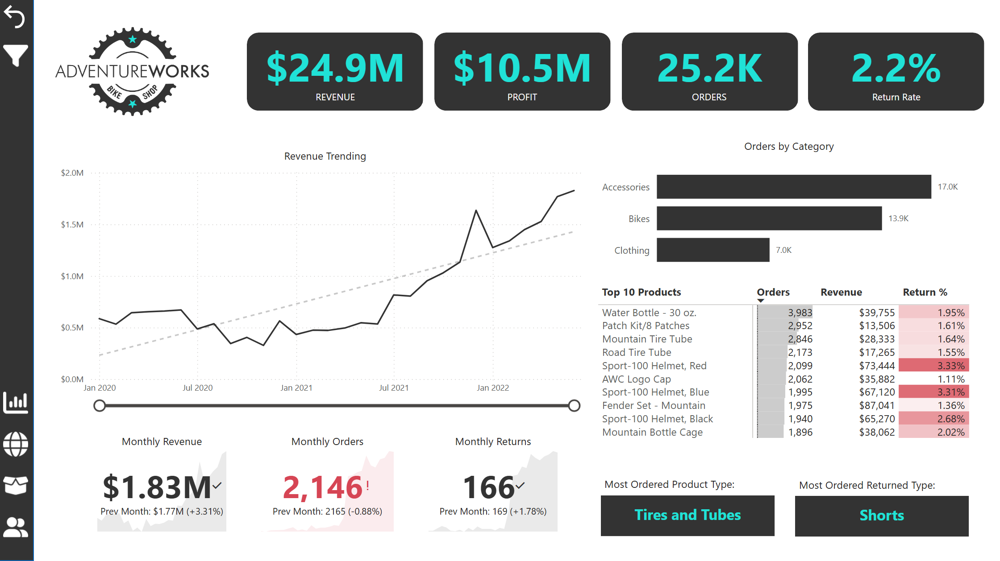
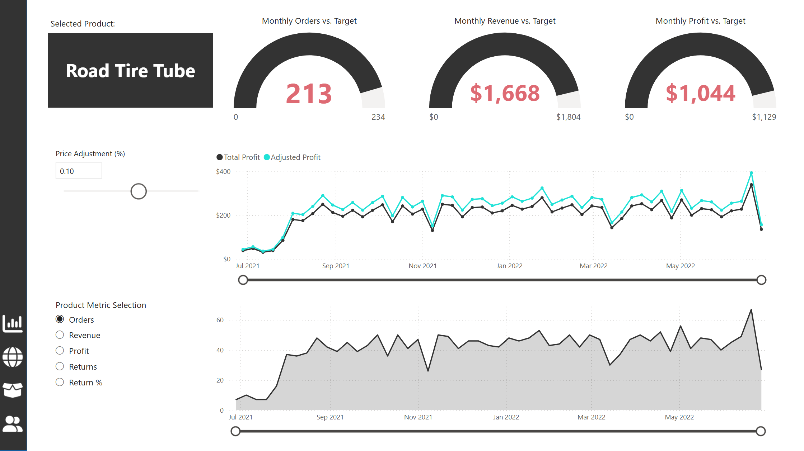
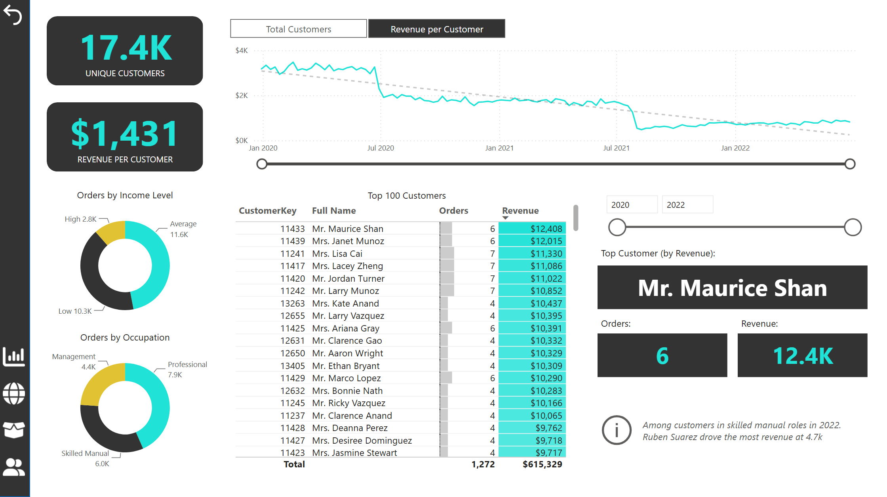

# AdventureWorks Sales Report

Power BI report on the AdventureWorks dataset: three years of sales, returns and customer data from a fictional retailer of bikes, accessories and clothing. Built during the [Maven Analytics Power BI course](https://www.udemy.com/course/microsoft-power-bi-up-running-with-power-bi-desktop/).

## Preview

**Executive overview.** Revenue, profit, orders and return rate, revenue trend, orders by category, top 10 products and month-over-month cards.

**Product detail.** Monthly orders, revenue and profit against target, a price adjustment what-if parameter, and a metric selector for the trend chart. Opened by drill-through from the overview.

**Customer detail.** Unique customers, revenue per customer over time, orders by income level and occupation, and the top 100 customers by revenue.

The report also has a map page with sales by country.

## Built with

- Power Query: cleaning, type fixes and shaping of the raw CSVs
- Data model: star schema with sales and returns facts and lookup dimensions
- DAX: core measures, time intelligence (previous month, targets), what-if parameter
- Report: drill-through, tooltip page, page navigation buttons, slicers

## Files

- `AdventureWorks_Report.pbix`: the report. Opens in Power BI Desktop (free, Windows).
- `AdventureWorks_Raw_Data/`: source CSVs
- `AdventureWorks_Images/`: logo and icons used in the report
- `docs/images/`: screenshots for this README
